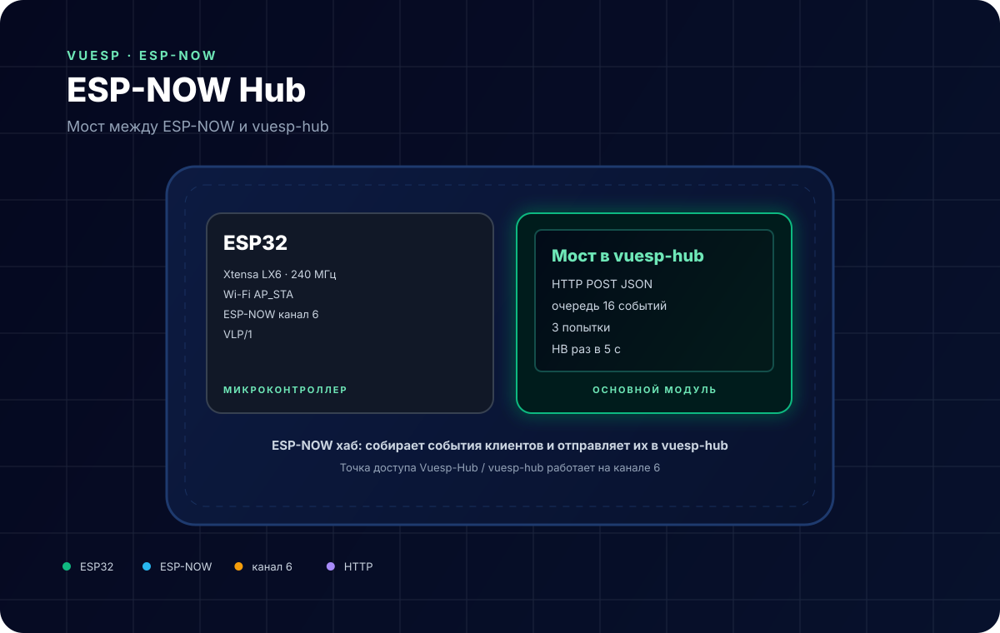
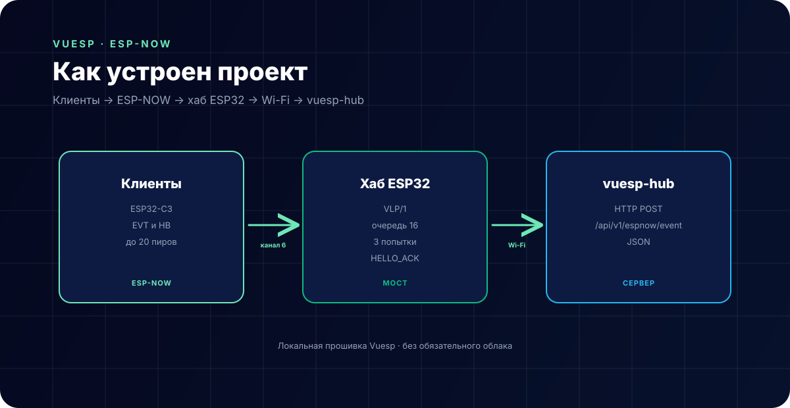

# ESP-NOW Hub — мост в vuesp-hub



**Коротко:** `vuesp.espnow-hub` — прошивка ESP32, которая принимает события ESP-NOW-клиентов, складывает их в очередь и пересылает JSON на сервер `vuesp-hub` по HTTP. Работает по протоколу **VLP/1** на канале 6.

## Что это за устройство

Хаб — это постоянный приёмник ESP-NOW:

- поднимает ESP-NOW на канале 6;
- создаёт точку доступа `Vuesp-Hub` / `vuesp-hub`;
- принимает `HELLO`, `EVT`, `HB` и `ACK`;
- запоминает MAC и ID клиентов (до 20);
- отвечает на `HELLO` кадром `HELLO_ACK`;
- складывает события в очередь (до 16);
- отправляет JSON на `HUB_SERVER_URL`;
- повторяет отправку до 3 раз, затем отбрасывает событие;
- раз в 5 секунд рассылает `HB`, чтобы клиенты находили хаб.

## Характеристики

| Параметр | Значение |
| --- | --- |
| Микроконтроллер | ESP32 (Xtensa LX6, 240 МГц) |
| Радио | Wi-Fi 2.4 ГГц, `WIFI_AP_STA` |
| Протокол | ESP-NOW, канал 6 |
| Формат | текст VLP/1 |
| Клиентов | до 20 |
| Очередь | 16 событий |
| Повторы HTTP | 3 |
| Период HB | 5 с |
| Среда | PlatformIO + Arduino |

## Распиновка

Отдельных пинов хаб не требует — только питание и USB для прошивки. Свободные GPIO можно использовать как обычные порты Vuesp.

| Сигнал | GPIO |
| --- | --- |
| Питание | 5 В / 3.3 В |
| USB | прошивка и монитор 115200 |
| Антенна | встроенная, не закрывать металлом |

## Схема подключения

```text
клиенты ESP32-C3 ──ESP-NOW/канал 6──► хаб ESP32 ──Wi-Fi/HTTP──► vuesp-hub
```

- Хаб должен быть в зоне радиовидимости клиентов; ESP-NOW не проходит через стены так же хорошо, как Wi-Fi с антенной.
- Для пересылки нужен работающий Wi-Fi до роутера и доступный сервер `vuesp-hub`.
- Точка доступа `Vuesp-Hub` нужна только для первоначальной настройки; ESP-NOW работает независимо.

## Протокол VLP/1

Кадры — текст до 220 байт (лимит ESP-NOW — 250 байт):

```text
VLP1|EVT|src=A1B2C3D4|seq=12|up=34567|k=btn|gpio=4|val=1.00
VLP1|CMD|dst=A1B2C3D4|mid=...|action=relay|gpio=5|val=1.00
VLP1|ACK|src=A1B2C3D4|mid=...|ok=1
VLP1|HB|src=A1B2C3D4|seq=13|up=40000
```

| Тип | Направление |
| --- | --- |
| `HELLO` / `HELLO_ACK` | клиент ↔ хаб |
| `EVT` | клиент → хаб |
| `HB` | обе стороны |
| `CMD` | хаб → клиент |
| `ACK` | клиент → хаб |

JSON, который уходит на сервер:

```json
{"v":1,"hub":"A1B2C3D4","src":"11223344","seq":12,"up":34567,"name":"btn","gpio":4,"value":1.0}
```

## Настройка

В `src/espnow/espnow.cpp`:

```cpp
#define ESPNOW_CHANNEL 6
#define HUB_SERVER_URL "http://192.168.1.10:3005/api/v1/espnow/event"
```

Канал должен совпадать у хаба и всех клиентов. `HUB_SERVER_URL` — адрес `vuesp-hub` в локальной сети.

> **Важно.** Пересылка выполняется только при `WiFi.status() == WL_CONNECTED`. Хаб должен быть подключён к роутеру как STA (настройки Wi-Fi в веб-интерфейсе). При заводском режиме `AP` очередь будет копиться, но не отправится. По умолчанию в текущей версии `vuesp-hub` эндпоинта `/api/v1/espnow/event` нет — его нужно реализовать на стороне сервера.

## Как устроен проект



- `src/espnow/espnow.cpp` — ESP-NOW, пиры, очередь, HTTP;
- `src/espnow/vlp.h` — формат кадров;
- `src/device/device.cpp` — стандартное устройство Vuesp и `http`-функция;
- `vue/` — локальный веб-интерфейс для настройки Wi-Fi и просмотра состояния.

Цикл:

```text
ESP-NOW EVT → очередь → HTTP POST → 2xx: удалить из очереди
                                   → ошибка: +1 попытка, после 3 — удалить
```

## ScriptRunner

| Функция | Назначение |
| --- | --- |
| `http(method, url, count, num, data)` | заготовка HTTP-запроса |
| `$display` | строковый буфер для сценариев |

Пример:

```text
log('espnow hub ready');
```

## Сборка и прошивка

```bash
cd vue
npm ci
npm run build-web

cd ..
~/.platformio/penv/bin/pio run -e esp32
~/.platformio/penv/bin/pio run -e esp32 -t upload
~/.platformio/penv/bin/pio device monitor -b 115200
```

## Ограничения

- Нет шифрования ESP-NOW: любой ESP32 на канале может отправить кадр.
- До 20 клиентов и 16 событий в очереди; при переполнении старые события вытесняются.
- После 3 неудачных попыток событие теряется без сохранения на диск.
- Пересылка требует подключения к роутеру (`WL_CONNECTED`); в режиме только AP очередь не уходит.
- Серверный эндпоинт `/api/v1/espnow/event` в текущем `vuesp-hub` отсутствует — нужна реализация.
- HTTP без TLS: используйте только доверенную локальную сеть.
- Точка доступа `Vuesp-Hub` имеет фиксированный пароль `vuesp-hub`; смените его в коде, если это важно.

## Источники

- [ESP-NOW — документация Espressif](https://docs.espressif.com/projects/esp-idf/en/latest/esp32/api-reference/network/esp_now.html)
- [ESP32 datasheet](https://www.espressif.com/sites/default/files/documentation/esp32_datasheet_en.pdf)
- [Документация Vuesp](https://docs.vuesp.ru)
